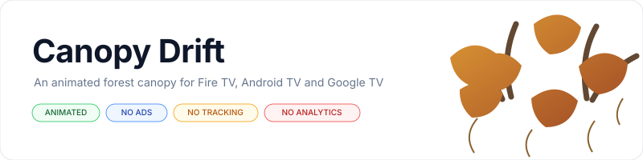
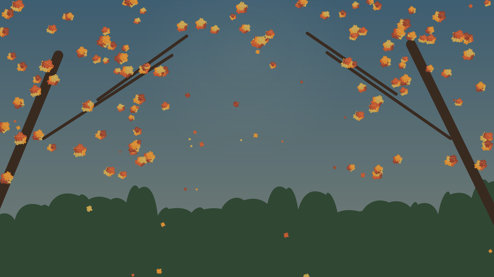
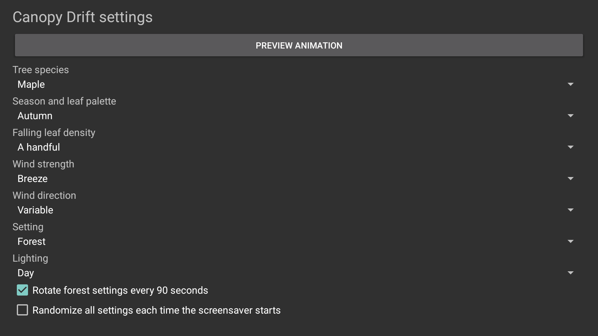

<p align="center">
    <picture>
        <source media="(prefers-color-scheme: dark)" srcset="art/banner-dark.svg">
        <source media="(prefers-color-scheme: light)" srcset="art/banner-light.svg">
        
    </picture>
</p>

<p align="center">An animated forest canopy with falling leaves for Fire TV, Android TV, and Google TV.</p>

<p align="center">
<a href="https://github.com/jeremykenedy/canopy-drift/releases"></a>
<a href="https://github.com/jeremykenedy/canopy-drift/releases"></a>
<a href="LICENSE"></a>
<a href="https://github.com/jeremykenedy"></a>
<a href="https://github.com/jeremykenedy/canopy-drift"></a>
<a href="https://github.com/jeremykenedy/canopy-drift/stargazers"></a>
<a href="https://github.com/sponsors/jeremykenedy"></a>
</p>

## Table of Contents

- [Privacy](#privacy)
- [Features](#features)
- [Requirements](#requirements)
- [Installation](#installation)
- [Configuration](#configuration)
- [Fire TV Toolkit](#fire-tv-toolkit)
- [Screenshots](#screenshots)
- [Building and testing](#building-and-testing)
- [Documentation](#documentation)
- [Releases](#releases)
- [Attribution](#attribution)
- [License](#license)

## Privacy

Canopy Drift has no ads, analytics, tracking, telemetry, crash reporting, or runtime network access. Its APK does not request internet permission. The optional installer contacts GitHub only when you run it to download the release APK and checksum.

## Features

- Continuously animated leaves fall past a gently moving forest canopy.
- Choose maple, oak, or birch trees, four seasonal palettes, and forest, riverside, or clearing scenes.
- Set a few, a handful, many, a ton, or schools of leaves.
- Adjust wind strength and direction, day, dusk, or night lighting, and scene rotation.
- Randomize each supported setting independently or randomize all selections at each start.
- Android TV, Google TV, and Fire TV DreamService integration with remote-friendly settings and preview.
- Exported, documented settings provider for host-app discovery.

## Requirements

Android 6.0 (API 23) or later. The app is built for Android TV-class devices. Fire TV, Android TV, and Google TV activation depends on each vendor's system screensaver support. Tested device results are documented in [verification](docs/VERIFICATION.md).

## Installation

Connect to the TV with ADB, then run `python3 install.py --serial TV_IP:5555`. The installer verifies the release APK against its published SHA-256 before installing or updating. Select Canopy Drift in the device's screensaver or ambient display settings afterward. See [installation](docs/INSTALLATION.md) for local builds and removal.

## Configuration

Open Canopy Drift from the TV launcher to change species, season, leaf density, wind, scene, lighting, and random choices. See [configuration](docs/CONFIGURATION.md) for the settings-provider contract.

## Fire TV Toolkit

[Fire TV Toolkit](https://github.com/jeremykenedy/fire-tv-toolkit) provides a guided CLI to install and update optional screensavers, choose the active screensaver, and manage supported screensaver timers and settings. Clone it and run its setup:

```bash
git clone https://github.com/jeremykenedy/fire-tv-toolkit.git
cd fire-tv-toolkit
node setup.js
```

After the Canopy Drift catalog entry is available, install or update it with `firetv-screensavers --install=canopy-drift --yes`, select it with `screensaver --set=canopy-drift`, and remove it with `firetv-screensavers --uninstall=canopy-drift --yes --force`. The standalone installer above can install Canopy Drift before catalog integration is available.

## Screenshots

These captures show Canopy Drift running on an Android TV emulator after the scene settled.

<p align="center"></p>

<p align="center"></p>

## Building and testing

Requires JDK 17+, Android SDK platform 36, build-tools 36.0.0, Python 3, and ADB for device installation. Run `bash build.sh` to build a signed local APK. Run `bash test.sh`, `bash scripts/check-style.sh`, `python3 scripts/check-docs.py`, and `python3 scripts/check-privacy.py` for checks. Details are in [building](docs/BUILDING.md) and [testing](docs/TESTING.md).

## Documentation

- [Architecture](docs/ARCHITECTURE.md)
- [Building](docs/BUILDING.md)
- [Configuration](docs/CONFIGURATION.md)
- [Installation and removal](docs/INSTALLATION.md)
- [Release process](docs/RELEASING.md)
- [Testing](docs/TESTING.md)
- [Troubleshooting](docs/TROUBLESHOOTING.md)
- [Device verification](docs/VERIFICATION.md)

Show some love by starring this repository on GitHub. The link opens the repository so signed-in visitors can select Star.

## Attribution

Canopy Drift adapts parts of the settings activity, app structure, settings provider, and standalone installer from [Firefly Grove](https://github.com/jeremykenedy/firefly-grove), under Apache-2.0. The canopy and leaf renderer and artwork are original to this project. See [NOTICE](NOTICE).

## Releases

- [Canopy Drift 1.0.0 release notes](docs/releases/v1.0.0.md)

## License

Canopy Drift is licensed under the [Apache License, Version 2.0](LICENSE). See [NOTICE](NOTICE) for project notices.
